# 网络层

## 网络层服务

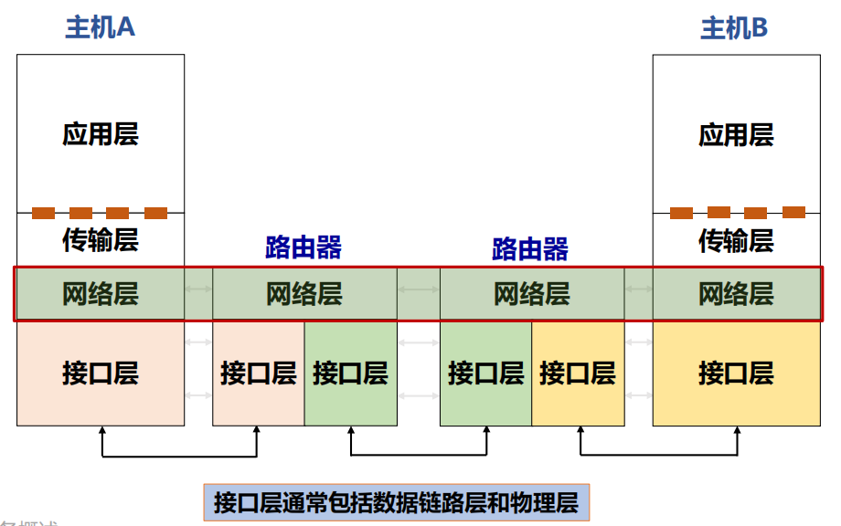

1. 网络层实现端系统间**多跳**传输可达
2. **路由器**：检查数据包首部，转发数据包
3. **关键功能**：
   1. 路由（控制面）：选择路径（==路由算法与协议==）
   2. 转发（数据面）：选择当前包在当前路由器的输出接口
4. **提供给传输层的服务**：无连接的数据报服务、面向连接的虚电路服务

#### 无连接的数据报服务

发送分组时不需要先建立连接

- 每个分组独立发送，<u>独立携带寻址信息</u>。
- 同一对主机之间的数据包，<u>可能经过不同路径</u>。

**尽力而为：**网络层不提供服务质量的承诺，==不可靠==，可能出现<u>丢包、乱序、错误</u>

> 优点：网络的造价大大降低，运行方式灵活，能够适应多种应用

**数据报转发策略**：基于分组的目的地址

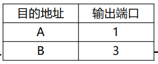

#### 面向连接的虚电路服务

先建立连接（请求分组->原路返回确认分组），再通信，最后释放连接。

- 建立时，沿途路由器保存该连接的转发状态
- 之后，属于该连接的数据包按照这些状态转发。

> 1. 但虚电路是一条**逻辑连接**，并不意味着独占一根物理线路。
> 2. **面向连接本身不等于绝对可靠。** 链路或设备失效，仍然可能导致通信中断，然后可能导致所有数据丢失。

**虚电路的转发策略**：基于分组标签，即虚电路号

> 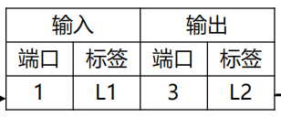
>
> 意思是：从端口 1 收到标签 L1 的包，就把标签改成 L2，从端口 3 发出。

#### 虚电路与数据报的比较

| 比较内容       | 虚电路                 | 数据报                               |
| -------------- | ---------------------- | ------------------------------------ |
| 发送前建立连接 | 需要                   | 不需要                               |
| 转发依据       | 已建立的标签映射       | 目的地址等转发信息                   |
| 网络中的状态   | 保存各虚电路状态       | 基本模型不保存逐连接的虚电路状态     |
| 路径           | 按建立的路径转发       | 分组独立转发，路径可能不同           |
| **顺序**       | **课件模型中保持顺序** | **可能乱序**                         |
| 故障影响       | 相关虚电路可能中断     | 在途包可能丢失，后续可随路由更新改道 |

##### 性能

1. 恒定流量：带宽不浪费，刚好满足要求

   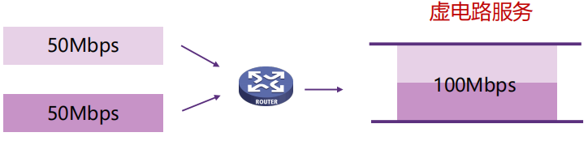

2. 突发流量：每个数据源的峰值为 70 Mbps，却只能获得 50 Mbps

   1. 虚电路（固定份额）<u>若缓冲不足，就会丢包</u>

      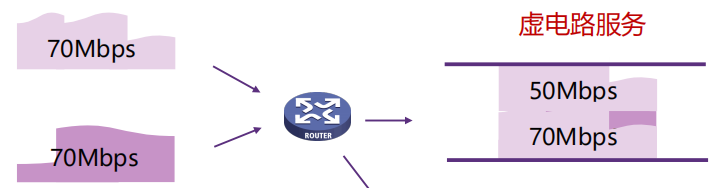

   2. 数据报：（统计复用：用户不总是同时活跃，因此可以共享总容量）

      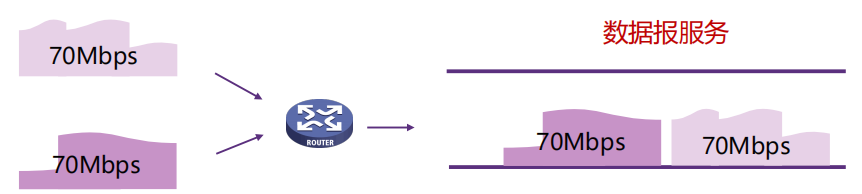

##### 效率

忽略源端首次发送时延、传播时延和拥塞排队，考虑三个转接节点：

\[ T_{\text{虚电路}} = S+3\left[D+\frac{P+H}{B}\right] \]

\[ T_{\text{数据报}} = 3\left[D+\frac{P+H}{B}\right] \]

其中：

- \(S\)：建立虚电路所需时间。
- \(D\)：每个节点的转接处理时延。
- \(B\)：传输速率，单位 bit/s。
- \(P+H\)：实际发送的分组总位数（长度+开销）。

## Internet 网际协议

### IPv4 协议（无连接的协议）

#### 数据报格式：首部+数据

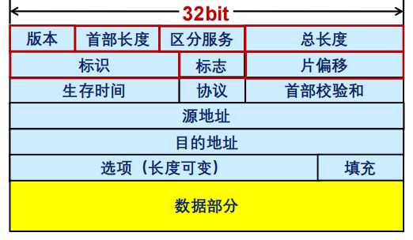

| 字段             | 长度   | 作用                                                         |
| ---------------- | ------ | ------------------------------------------------------------ |
| 版本             | 4 bit  | IPv4 的值为 4                                                |
| 首部长度 IHL     | 4 bit  | 表示首部**有多少个 4 字节**                                  |
| 区分服务字段     | 8 bit  | 一般情况下不使用（承载 DSCP、ECN 等信息）                    |
| 总长度           | 16 bit | 整个 IP 数据报的字节数                                       |
| 标识             | 16 bit | IP软件通过计数器自动产生，每产生1个数据报计数器加1；**在ip分片以后，用来标识同一片分片** |
| 标志             | 3 bit  | 控制和说明分片情况（目前只有两位有意义）<br />**MF**，置1表示后面还有分片，置0表示这是数据报片的最后1个<br />**DF**，不能分片标志，置0时表示允许分片 |
| 片偏移           | 13 bit | 分片数据在原始数据中的位置                                   |
| TTL              | 8 bit  | 限制数据包的转发寿命                                         |
| 协议             | 8 bit  | 标识上层协议（TCP/UDP/ICMP…）                                |
| 首部校验和       | 16 bit | 检测 IPv4 **首部差错**                                       |
| 源地址和目的地址 | 32 bit | 源 IPv4 地址                                                 |
| 目的地址         | 32 bit | 目的 IPv4 地址                                               |
| 选项与填充       | 可变   | 提供扩展功能并使首部对齐                                     |

#### 数据报分片

> **为什么需要分片**：不同链路能承载的包大小可能不同

**MTU** 是该链路允许承载的最大网络层数据包大小。

**路径 MTU** （Path MTU）则是整条路径上最小的链路 MTU。

> [!note]
>
> 
>
> **片偏移**：表示该片数据在==原始数据==部分中的起点- 
>
> - 不是相对 IP 首部，也不是相对上一个分片
> - 再次分片时，偏移仍相对于最初的原始数据计算
> - **偏移的单位是8字节**

**分片**：IPv4 可以由源主机分片，也可以在允许的情况下由途中路由器分片；已经产生的分片还可能再次被分片

**重组**：IPv4 最终重组由**目的主机**完成

- 重组依靠标识、标志、偏移、MF、长度，以及源地址、目的地址、协议等信息
- 收到 MF=0 的最后一片，不代表一定已经收齐，中间仍可能缺片

### IP地址

全球唯一的32位的标识符

**结构**：网络前缀+主机号

**分类**：A、B、C、D、E五类，A类、B类、C类为单播地址

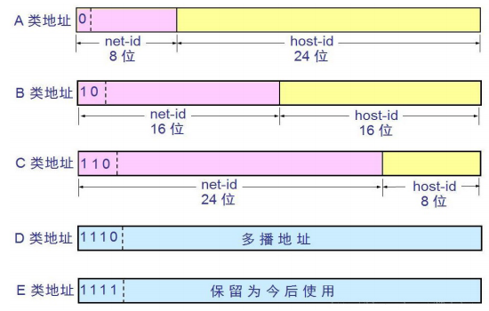

> [!note]
>
> `10.2.1.1`：A 类。
>
> `128.63.2.100`：B 类。
>
> `201.222.5.64`：C 类。
>
> `256.241.201.10`：非法，256 超过单字节范围。

> **特殊地址**：
>
> | 地址或形式      | 含义                                                     |
> | --------------- | -------------------------------------------------------- |
> | 主机位全 0      | 普通子网中的**网络地址**                                 |
> | 主机位全 1      | 普通子网中的**定向广播地址**                             |
> | 127.0.0.0       | **本地节点**（一般为 127.0.0.1）                         |
> | 全 0 网络地址   | 只在系统启动时有效，用于启动时临时通信，又叫**主机地址** |
> | 0.0.0.0         | 指**任意地址**                                           |
> | 255.255.255.255 | **本地链路有限广播**                                     |

#### 子网划分

两级IP地址：网络号+主机号 ----> 三级IP地址：网络号+子网号+主机号

> 子网掩码(subnet mask )：32 bit，置1表示网络位，置0表示主机位

> [!note]
>
> **Example:** 172.16.2.160，掩码 255.255.255.192
>
> **Answer:** 网络地址 = IP地址 AND 子网掩码，则主机位 6 bits
>
> - 主机位全0，子网地址172.16.2.128
> - 主机位全1，广播地址172.16.2.191
> - 主机数：\[ 2^6-2=\boxed{62} \]

#### CIDR 无类域间路由

使用可变长度网络前缀描述地址块：**网络地址/前缀长度**

> [!note]
>
> **Example 1**：地址拆分
>
> 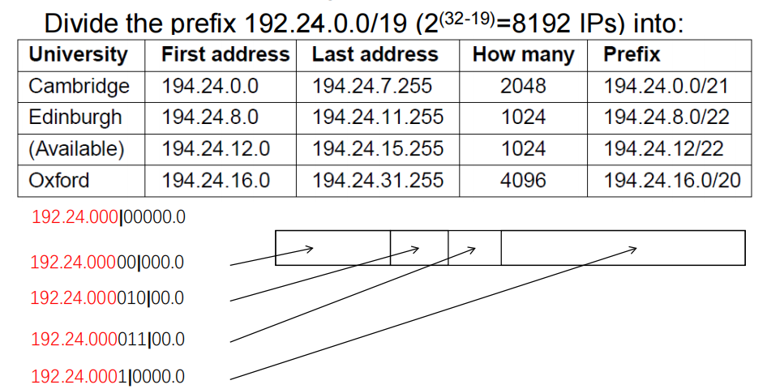
>
> **Example 2**：从 `202.101.0.0` 开始，依次为 A、B、C、D、E 分配 1024、2000、2000、4096、512 个地址，要求**包含特殊地址**。
>
> A	202.101.0.0/22	202.101.0.0—202.101.3.255
> B	202.101.8.0/21	202.101.8.0—202.101.15.255
> C	202.101.16.0/21	202.101.16.0—202.101.23.255
> D	202.101.32.0/20	202.101.32.0—202.101.47.255
> E	202.101.4.0/23	202.101.4.0—202.101.5.255

**路由聚合**：把多个合适的小地址块，用一个更大的公共前缀表示

> 192.168.0.0/24、192.168.1.0/24可以聚合为：192.168.0.0/23

**最长前缀匹配**：同一目的地址可能同时匹配多条路由，选择其中前缀位数最多的一条

> [!note]
>
> 前缀	         接口
> 2.128.0.0/9	1
> 2.192.0.0/10       2
> 2.0.0.0/8	    3
> 2.2.3.0/24	  4
> 0.0.0.0/0	    5
>
> - 2.5.1.2：匹配 /8，不在更具体的几个范围中 → 接口 3。
> - 2.200.1.2：匹配 /8、/9、/10，最长是 /10 → 接口 2。
> - 2.150.1.2：匹配 /8 和 /9，最长是 /9 → 接口 1。
> - 3.150.1.2：不匹配上述以 2 开头的前缀 → 默认路由 接口 5。

#### DHCP 动态主机配置协议

> IPv4 地址的获取：
>
> - 静态设定：申请固定IP地址，手工设定，如路由器、服务器
> - 动态获取：使用DHCP协议或其他动态配置协议

当主机加入IP网络，允许主机从DHCP服务器动态获取IP地址

**优点**：可以有效利用IP地址，方便移动主机的地址获取

**工作模式**：客服/服务器模式（ C/S ）；基于 **UDP** 工作，服务器运行在 67 号端口， 客户端运行在 68 号端口

| 阶段     | 报文         | 含义                     | 传输形式 | 目标IP          | 源IP                           |
| -------- | ------------ | ------------------------ | -------- | --------------- | ------------------------------ |
| Discover | DHCPDISCOVER | 客户端寻找 DHCP 服务器   | 广播     | 255.255.255.255 | 0.0.0.0                        |
| Offer    | DHCPOFFER    | 服务器提供候选配置       | 广播     | 255.255.255.255 | DHCP服务器或中继路由器的IP地址 |
| Request  | DHCPREQUEST  | 客户端表明选择并请求配置 | 广播     | 255.255.255.255 | 0.0.0.0                        |
| ACK      | DHCPACK      | 服务器确认配置           | 广播     | 255.255.255.255 | DHCP服务器或中继路由器的IP地址 |

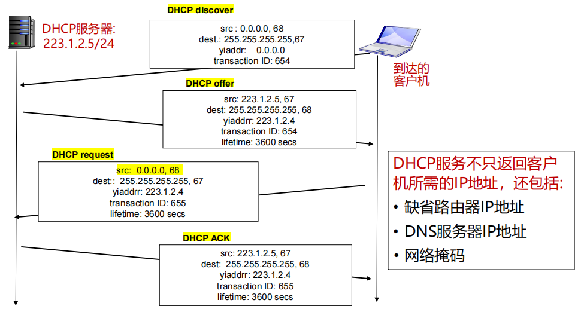

> **IP与MAC地址**：最终目的地由 IP 地址表达，当前这一跳交给谁由链路层地址表达
>
> - IP 地址放在 IP 数据报的首部，而硬件地址则放在 MAC 帧的首部
> - IP数据报经过不同链路时，IP 数据报中封装的IP地址不发生改变，而Mac帧中的硬件地址是发生改变的

#### ARP 地址解析协议

**根据目标 IPv4 地址，获取同一链路上对应接口的 MAC 地址。**

> A 想给 B 发送数据，但只知道 B 的 IP 地址

1. A 查询本地 **ARP 缓存**。
   1. 若已有映射，直接使用。
   2. 若没有，**广播** ARP 请求。
2. B 收到请求，发现询问的是自己，通常单播回复，发送 MAC 地址给 A
3. A 缓存映射，再发送数据。

> 如果 A 和 B 不在同一个局域网中：A 不会解析远端 B 的 MAC 地址，而是解析下一跳网关的 MAC 地址。

#### NAT 网络地址转换

**用于解决IPv4地址不足的问题，是一种将私有（保留）地址转化为公有IP地址的转换技术**

1. 转换的不只是 IP 地址，还包括**端口号**
2. NAT转换表：每个 (源IP地址, port #) 到 (NAT IP地址, 新port #) 映射项
3. 优势：保护局域网的私密性；节省合法地址
4. 缺点：违反了端到端的原则；违反了最基本的协议分层规则
5. **NAT Traversal Problem**：局域网中有一台服务器，外部客户端想主动连接这台服务器
   1. 中继 relaying：内网服务器主动连接中继服务器，外部客户端也连接中继服务器，中继服务器在两者之间转发数据。

#### ICMP Internet 控制报文协议

ICMP 允许主机或路由器<u>报告差错情况和提供有关异常情况的报告</u>

1. ICMP 报文携带在IP 数据报中

2. **报文类型**：差错报告报文、询问报文

3. **报文格式**：前 4 个字节包含格式统一的三个字段：<u>类型、代码、检验和</u>；相邻的后四个字节内容与ICMP的报文类型有关

   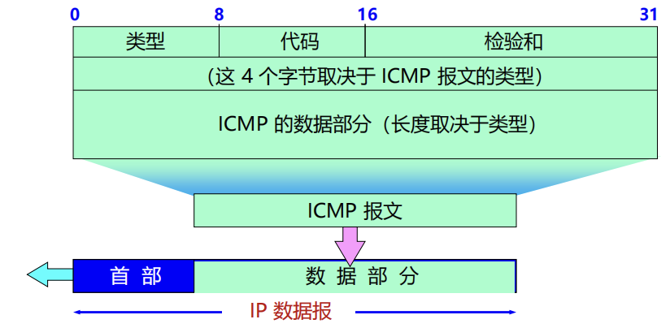

4. **PING** 用来测试两个主机之间的连通性

   1. 使用了 ICMP 回送请求与回送回答报文 Echo Request / Echo Reply

   2. 可以得到的信息：连通性、往返时延、单向转发跳数TTL

      > **能否根据返回 TTL 猜测远端主机操作系统？**
      >
      > 思路是不同系统常使用不同的初始 TTL，比如常见初始值可能是 64、128、255，然后结合路径跳数反推。

5. **TraceRT** 得到整个路径上路由器的地址

   1. **原理**：逐渐增大 TTL：

      ```
      TTL=1 → 第1个路由器丢包 → ICMP Type 11 Code 0（TTL 过期）
      TTL=2 → 第2个路由器丢包 → ICMP Type 11 Code 0
      TTL=3 → 第3个路由器丢包 → ICMP Type 11 Code 0
      ...
      ```

      路由器返回的 ICMP 报文源 IP，就是该跳路由器地址。

   2. **停止条件**：最终到达目的主机后，由于 UDP 使用不存在的端口，目的主机返回 **Type 3, Code 3**；源收到 `3/3` 后停止跟踪

## 路由算法

> 路由算法要解决的是：一个数据包从当前路由器到目标节点，应该走哪条路？

路由算法应该满足的性质：正确性、简单性、鲁棒性、稳定性、公平性、有效性

按照是否会根据网络状态变化自动调整，分为：

- **静态路由**：不自适应
- **动态路由**：会根据链路、拓扑、流量变化重新计算

> **汇集树**(Sink Tree)：所有源节点到一个指定目标节点的最优路径集合，构成一棵以该目标节点为根的树。（**不是唯一的**）
>
> 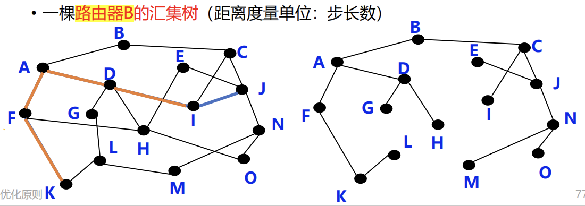

> **最短路径算法 Dijkstra**
>
> 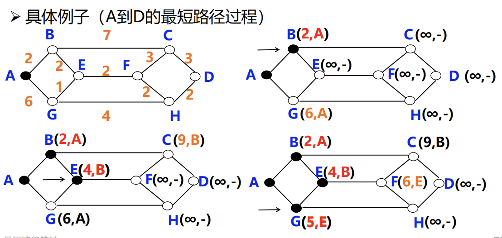

### 距离向量路由 DV

每个路由器**不知道完整网络拓扑**

> **Bellman-Ford 方程**：\[ \boxed{D_x(y)=\min_m\{c(x,m)+D_m(y)\}} \]
>
> x 到 y，要么经过邻居1，要么经过邻居2……把每种情况都算出来，取最小值。

**基本思想**：每个节点周期性地向邻居发送它自己到某些节点的距离向量；当节点 x 接收到来自邻居的新 DV 估计，它使用 B-F 方程更新其自己的 DV

**算法特点**：迭代的（不是一次算完）、分布式的（没有中央控制器）

**缺点**：好消息传播快，坏消息传播慢

> A -- B -- C：B 到 A 的链路断开后：C 仍认为可以通过 B 到达 A，B 又错误地认为可以通过 C 到达 A，双方不断增加到 A 的估计距离（**Count-to-Infinity**）
>
> > 路由器只知道邻居报告的距离，不知道邻居的路径是否实际上又经过自己，因此可能形成**路由环路**。
>
> **解决方案**：毒性逆转 Poisoned Reverse
>
> 如果 C 到 A 是通过 B，那么 C 在向 B 报告时，不说：我到A=2，而说：\[ \boxed{C\rightarrow A=\infty} \]
>
> > **不能彻底解决**：主要可以防止简单的两节点相互欺骗。但如果出现更长的环路，仍可能出现计数到无穷。

### 链路状态路由 LS

> DV：只知道邻居报告的距离。
>
> LS：通过链路状态分组掌握**全网拓扑**

1. 发现邻居
2. 设置到每个邻居的成本度量（<u>多种度量</u>）
3. **构造链路状态 LS 分组**：发送方标识、序列号、年龄、邻居列表
4. 将 LS 分组发送给其他路由器（每个LS分组包含一个<u>序列号</u>，且递增，用于判断新旧）
5. 使用最短路径算法 **Dijkstra** 计算路由

> LS与DV：LS 全网扩散、自己测量、各自计算，健壮性好、收敛速度快

### 层次路由

> 为什么前面已经有 Dijkstra / DV / LS，还要层次路由？
>
> 因为现实中的 Internet 太大，<u>路由表过于庞大</u>、存储和查找困难、路由信息交换开销高。
>
> > **地址聚合**虽然有帮助，但不够
> >
> > 如果地址连续：PC1、PC2，可以聚合成：PC1-PC2，减少路由表项。但现实中地址分配可能随机，不总能高效聚合；而且不同网络管理员希望自己管理自己的网络。

**自治系统 AS**：由一个管理机构控制，每个 AS 有唯一 AS ID

- 自治系统内部使用内部网关路由协议 **IGP**：OSPF，RIP，IS-IS，IGRP，EIGRP…
- 自治系统之间使用外部网关路由协议 **EGP**：BGP

> 这些路由协议在[路由协议](#Internet 路由协议)部分详细介绍

### 广播路由

**Broadcasting**：源主机同时给全部目标地址发送<u>同一个</u>数据包，**不同方法**：

1. 方法一：逐个单播：浪费带宽、必须知道所有目的地址

2. 方法二：**多目标路由**：发一个带多个目标的包，在网络分叉处才**复制**

   1. 网络利用率更高，但仍然要知道所有目的地址，难以实现

3. 方法三：Flooding **泛洪**：收到一个包后，从除了入接口以外的所有接口转发

   1. 无控制的：==环路可能导致广播风暴==（大量重复）

   2. **受控泛洪**：

      1. **序号控制泛洪**：每个广播包携带：<u>源S + 序列号n</u>，路由器记录自己见过的，如果记录里已有：丢弃；如果没有：记录，然后继续广播。

      2. **逆向路径转发**：只有当广播数据包从<u>通往源节点的最佳路径对应接口</u>到达时，才继续转发

         > **不能**完全避免重复分组（可以减少重复包，但不能保证每个节点只收到一份）

4. 方法四：生成树：先建立一个：Spanning Tree，然后广播包只沿这棵树传播

   1. 没有环、没有冗余路径、副本数量少、带宽利用率高

### 组播路由

**multicasting**：源主机给网络中的一部分目标用户发送数据包

**目标**：为每个组建立<u>组播转发树</u>、每个成员最好<u>只收到一份</u>、非成员不应该收到、从源到成员的路径<u>尽量最优</u>

**步骤**

1. **确定组成员 IGMP**：路由器获悉该网段的组播组成员
2. **建立组播树**——路由器与路由器之间的协议
   1. **密集**分布，基于源点树：每个发送源建立一棵自己的树
      1. 路径<u>比较接近</u>源点到各成员的**最佳**路径
      2. 但是组播源很多时，路由器需生成多颗棵树，工作量巨大、存储开销很大
   2. **稀疏**分布，基于核心树：多个组播源共享一棵树
      1. 选择一个核心节点 Core，所有组成员围绕这个核心建立共享树
      2. <u>路径可能不是最优</u>

> 常用组播地址段：224.0.0.0/24
>
> 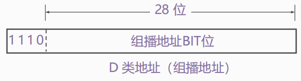

### 选播路由

**Anycast**：将数据包传送给**最近**的一个组成员

> 典型应用 **DNS**：在没有指定DNS服务器的情况下，用户将始终连接到“最接近”服务器

## Internet 路由协议

### OPSF 内部网关路由协议

Open Shortest Path First，开放最短路径优先协议

**采用分布式的链路状态算法 LS**

**LSDB**：链路状态数据库

- 每个路由器收到其他路由器的链路状态之后，会建立一个
- 可以理解为当前区域的完整网络拓扑图

**Area**：OPSF 使用**层次结构的区域划分** 

- 上层的区域叫做**主干区域**(backbone area)，其他区域都必须与主干区域相连
- 非主干区域之间不允许直接发布区域间路由信息

> **路由器角色**
>
> - 内部路由器 (Internal Router，**IR**)
> - 区域边界路由器 (Area Bounder Router，**ABR**)
> - 自治系统边界路由器(AS Bounder Router, **ASBR**)
>
> 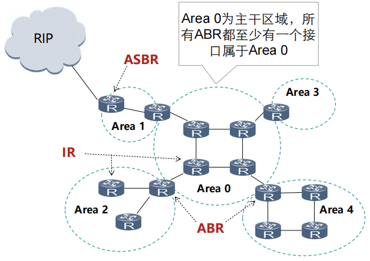

> [!NOTE] 
>
> 1. 为什么 OSPF 适合大型网络？ 
>
>    1. OSPF 是链路状态协议，收敛快
>    2. OSPF 支持 Area 分层
>
> 2. OSPF 会不会有“坏消息传得慢”的问题？
>
>    不会，链路状态变化后，把这个事实洪泛给大家。

### RIP 内部网关路由协议

路由选择协议RIP（ Routing Information Protocol ）是**基于距离矢量算法 DV** 的协议

使用**跳数**衡量到达目的网络的距离：

- 经过的路由器越少，认为路径越好

- 允许一条路径**最多只能包含 15 个路由器**

  > 在 RIP 中，16 表示不可达，这就是 <u>RIP 不适合大型网络的重要原因之一</u>。

**基本思想**：仅和==相邻==路由器交换信息；交换的内容是自己的==路由表==；==周期性==更新：30s（交换整个路由表）

> RIP 防环机制：触发更新（发生重要变化时立即发送更新）、毒性反转、水平分割

### BGP 外部网关路由协议

Border Gateway Protocol，边界网关协议（目前互联网中唯一实际运行的自治域间的路由协议）

> BGP 的核心不是只找最短，而是在*策略约束*下选择最优路径

**功能**

- **eBGP**：从相邻的 AS 获得网络可达信息
- **iBGP**： 将网络可达信息传播给 AS 内的路由器

BGP 是**路径向量协议**（路径经过哪些AS）

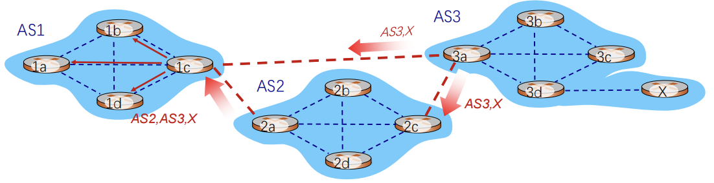

一条路由“route” = prefix（目的网络前缀） + attributes（属性）

> 图中的 X 表示一个目的网络前缀（network prefix），X 是挂在 AS3 后面的某个网络

**两个重要属性**

- AS路径（**AS-PATH**）：IP前缀通过经过的所有AS号，如：AS 67, AS 17 
- 下一跳（**NEXT-HOP**）：说明路由信息对应的下一跳IP地址

**路由选择**：同一个目标网络可能收到很多条 BGP 路由，需要选择一条最佳路由，**选择规则**：

1. *本地偏好* Local Preference
2. 最短 AS-PATH
3. 最近的 NEXT-HOP
4. 其他标准
5. 最低路由器 ID

**BGP 报文**：BGP通过 **==TCP 的 179 端口==**交换报文

- **Open** 报文：用于<u>建立BGP对等体之间的会话连接</u>，协商BGP参数（该过程需要认证）
- **Update** 报文：用于在对等体之间<u>交换路由信息</u>
- **Keepalive** 报文：用于<u>保持BGP会话连接</u>
- **Notification** 报文：用于<u>差错报告和关闭BGP连接</u>

> 第一次建立 BGP 时邻居之间交换完整 BGP 路由表；**之后只在发生变化时更新变化的部分**。
>
> **BGP会话:** 两个BGP路由器通过**TCP**连接交换BGP报文

### MPLS 多协议标签交换

MultiProtocol Label Switching

1. 标签交换路由器 **LSR**：具备标签交换、路由选择两种功能
2. **MPLS Domain**：一组<u>相邻的支持 MPLS</u> 的路由器构成
3. **标签分配协议 LDP**：用来在LSR之间建立LDP 会话并交换Label/FEC映射信息

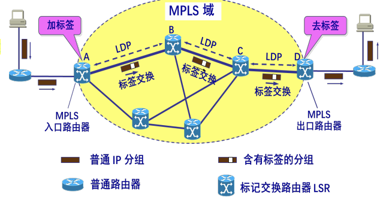

**工作过程**：

1. 加标签：在 <u>MPLS 域的入口处</u>，给每一个 IP 数据报加上标签
2. 标签交换：采用硬件技术对加上标记的 IP 数据报**进行转发**
3. 去标签：当分组离开 MPLS 域时，<u>MPLS 出口路由器</u>把分组的标签去除

## 路由器工作原理

分成两个逻辑部分：

1. **控制层** Control Plane

   1. 运行**路由协议**：可同时运行多个；也可不运行任何路由协议，<u>只使用静态路由和直连路由</u>

   2. 学习到不同目的网络的路径

   3. **生成路由表**：路由管理根据<u>路由优先级</u>，选择最佳路由，形成核心路由表

      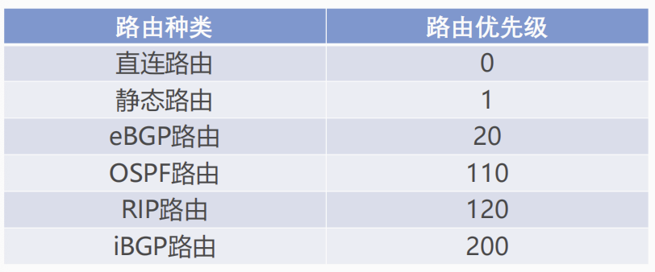

   4. 控制层将核心路由表下发到数据层，形成**转发表（FIB）**

2. **数据层** Data Plane：根据上述路由表（实际**FIB**），将收到的IP分组**转发**到正确的下一跳链路

   1. 用目的IP地址，基于**最长前缀**匹配规则查询转发表
   2. IP报文在路由器转发前后的变化：*链路层封装更新，IP头部“TTL”减1，IP头部“校验和”更新*
   3. 普通 IP 报文转发过程中，路由器不查看传输层及以上层协议的内容

> **数据报在不同硬件单元的处理**：报文输入的接口卡(**转发表查询**) -> 交换结构 -> 报文输出的接口卡（可能排队）
>
> **三种典型的交换结构**
>
> 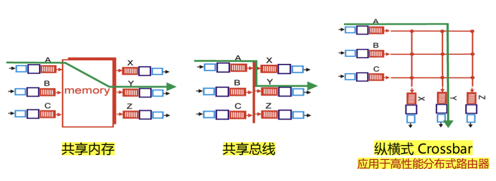

> 家用路由器与典型网络路由器差异较大

## VPN

> 计算机网络按用途分类：专用、公用
>
> 专用网络的实现方式：
>
> • 使用专用链路：铺设、租用（费用高，不灵活）
>
> • 使用公共链路：不安全

**VPN**指利用<u>公用网络</u>架设专用网络的远程访问技术

通过**隧道技术**在公共网络上模拟出一条**点到点**的逻辑专线，从而达到**安全数据传输**的目的

> R1 把**整个原始数据报当作新的数据部分**，然后在外面再加一个新的 IP 首部
>
> 内层地址：最终通信双方；外层地址：隧道起点和终点
>
> 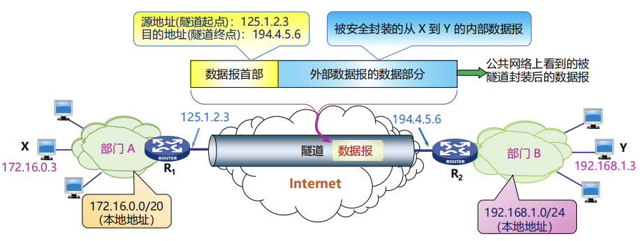

> **VPN对数据机密性和完整性的保护**
>
> - **Hash**：得到摘要，用于完整性
> - **加密**：保证机密性
>
> 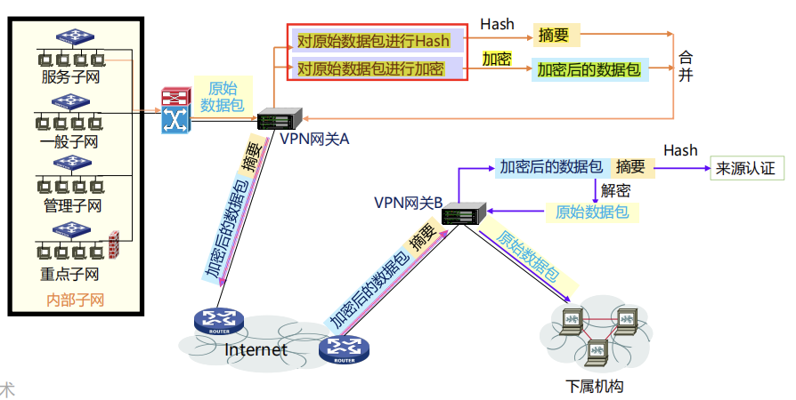

## IPv6 协议

IPv6 是 IETF 设计的下一代 Internet Protocol，用来替代 IPv4

**IPv6 地址**：

- 地址长度为 **128bit**，是IPv4地址长度的4倍

- 表示法，冒分十六进制，`x:x:x:x:x:x:x:x`

  > 2001:0DA8:0000:0000:200C:0000:0000:00A5 简化：
  >
  > 每个 x 前面的 0 可省略，可把连续的值为 0 的 x 表示为 “::” , 且 “::” 只能出现 1 次
  >
  > 2001:DA8:0000:0000:200C::A5

**IPv6 基本首部**：永远是 40 Bytes

- 版本：4bit，协议版本号，值为6
- **流量类型**：8bit，区分数据包的<u>服务类别或优先级</u>
- **流标签**：20bit，标识<u>同一个数据流的分组</u>
- 有效载荷长度：16bit ，IPv6报头之后载荷的字节数（含扩展头），最大值64K
- **下一个首部**：8bit ，IPv6报头后的协议类型，可能是TCP/UDP/ICMP等，也可能是扩展头
- **跳数限制**：8bit ，类似IPv4的**TTL**，每次转发跳数减1，值为0时包将会被丢弃

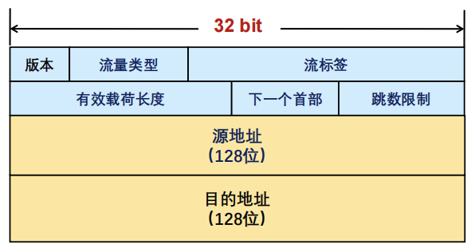

> 去除“首部长度”（首部长度固定为40字节）
>
> 去除“首部校验和”（传输层校验会涉及伪头部信息），**提升转发速度**
>
> 去除分片字段：“标识”“标志”“片偏移” ，移至***扩展头***（分段头）

**IPv6分片机制**：IPv6分组**不能在传输途中分片，只在源端进行分片**；IPv6支持Path MTU发现机制

**IPv6扩展头**：

- IPv6报文可承载多个扩展头；如有多个扩展头，需<u>按规定顺序</u>出现：
  - 逐跳选项头：转发路径上每个节点都需检查
  - 路由头：指明转发途中需经过哪些节点
  - 分段头：包含分片处理信息：片偏移、 “更多段”标志、标识符
  - 目的地选项头：目的端系统需要确认的信息
- 每个扩展头都包含“**下一个首部**”字段

**IPv6地址分类**

- **未指定地址**（::/128），不能分配给任何节点
- **回环地址**（::1/128），表示<u>节点自己</u>，不分配，类似IPv4中的127.0.0.1
- **组播地址**（FF00::/8）
- **链路本地地址**（FE80::/10），也称为Link-local地址，仅在本地链路上使用，网络设备根据接口MAC地址自动生成
- 全局单播地址，其它地址

> IPv6地址配置方式：手动配置、DHCPv6（IPv6动态主机配置协议）、无状态地址自动配置

**IPv4到IPv6迁移及过渡技术**：双栈技术、隧道技术、翻译技术

> **隧道技术**：两个*同构*网络的系统跨越*中间异构*网络进行通信。
>
> 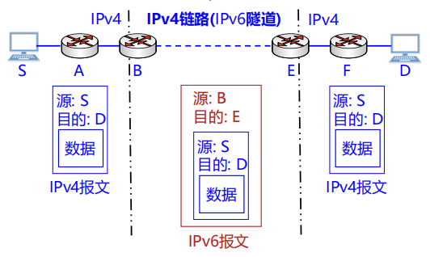